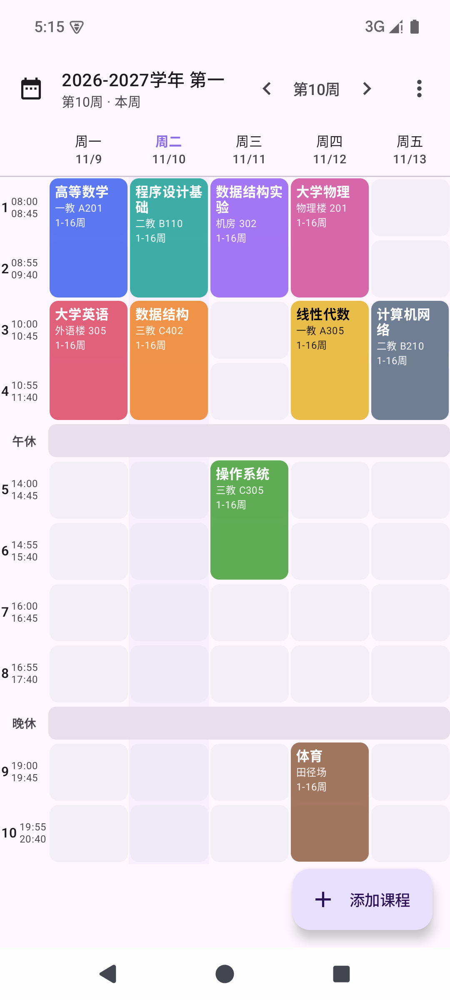
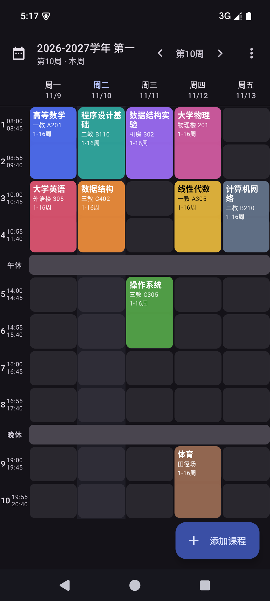
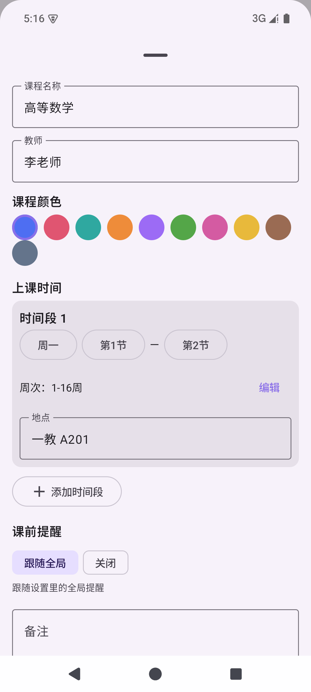
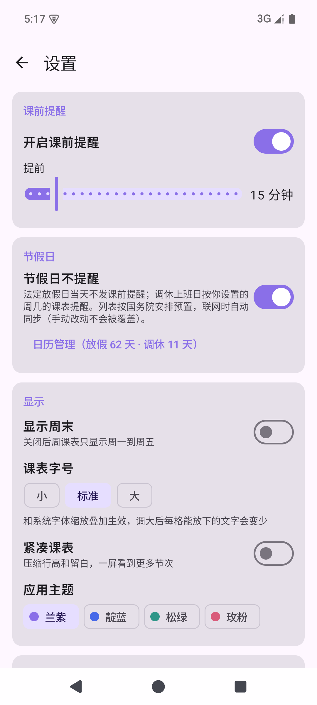

**English** | [简体中文](README.zh-CN.md)

  

  # Bitter Melon Timetable

  **A fully offline Android timetable · No account · Class reminders · Home-screen widgets**

  Import your timetable once, then view and edit courses and get notified before class. No sign-up, no tracking — your schedule never leaves the device.

  
  
  
  
  

  **[Download](#-download) · [Features](#-features) · [Network & privacy](#-network--privacy) · [Build from source](#-build-from-source)**

## 📷 Screenshots

<table align="center">
  <tr>
    <td align="center"> <b>Weekly grid</b> (auto week number)</td>
    <td align="center"> <b>Dark mode</b> (follows system)</td>
    <td align="center"> <b>Course editor</b> (arbitrary week sets)</td>
    <td align="center"> <b>Settings</b> (reminders / holidays / themes)</td>
  </tr>
</table>

## 📥 Download

Grab the APK for your device architecture from the [**latest release**](https://github.com/Balsam1213/bitter-melon-timetable/releases/latest) (requires Android 8.0+):

| APK | For |
|---|---|
| [`app-arm64-v8a-release.apk`](https://github.com/Balsam1213/bitter-melon-timetable/releases/latest/download/app-arm64-v8a-release.apk) | Virtually all modern phones (**recommended**) |
| [`app-armeabi-v7a-release.apk`](https://github.com/Balsam1213/bitter-melon-timetable/releases/latest/download/app-armeabi-v7a-release.apk) | Older 32-bit phones |
| [`app-x86_64-release.apk`](https://github.com/Balsam1213/bitter-melon-timetable/releases/latest/download/app-x86_64-release.apk) | Emulators / x86 devices |
| [`app-universal-release.apk`](https://github.com/Balsam1213/bitter-melon-timetable/releases/latest/download/app-universal-release.apk) | Universal fallback if unsure (larger) |

> [!IMPORTANT]
> v1.3 and earlier were signed with the debug key; from v1.4 on a formal key is used. **Uninstall the old version before covering-install**, then restore your data from a JSON backup (a manual export, or the daily auto-backups under Documents/苦瓜课表). The signature stays the same from v1.4 onward, so later updates install over each other normally.

## ✨ Features

- **Weekly timetable grid** — courses shown by week with the current week number calculated automatically; swipe between weeks, pull down to jump, today highlighted; the weekend column can be toggled.

- **Five import methods** — everything goes through a preview step before anything is written: entries with problems are flagged in red with the reason and unchecked by default; fix them and re-check to import.
  - Excel (.xlsx) / CSV files (UTF-8 and GBK encodings both work)
  - JSON backup files (this app's own export format)
  - Offline OCR of timetable screenshots (ML Kit Chinese text recognition, model bundled in the APK — no network)
  - Manual entry
  - Academic affairs (教务网) import (needs network)

  

  
Academic affairs import: details and safety measures

  The app opens your school's academic affairs website in an in-app WebView (defaults to Southwest Jiaotong University, changeable to any school), where you log in manually, open the "My Course Selection Records" or "This Semester's Timetable" page, and import with one tap. Plaintext http addresses and certificate errors both trigger an explicit risk warning first (credentials could be intercepted) and only proceed after you confirm; navigating to a different site asks too. Compatible with http sub-sites and self-signed certificates of campus systems; supports pinch-to-zoom; white screens caused by broken CSS height chains on some admin portals are auto-repaired. The fetched page is parsed locally — timetable data is never uploaded.

  

- **Course management** — one course can have multiple time slots; **arbitrary week sets** (e.g. weeks "1-8, 11-16" — odd/even weeks are just quick presets); custom colors, teacher, room, and notes; time-conflict detection on save; quick filtering by name / teacher / room on the course list page.

- **Class reminders** — a global lead time of 0–120 minutes, disable-able per course; fired via exact alarms and automatically rescheduled after reboot / app update; alarms go through the `setAlarmClock` channel, immune to Doze batching and vendor battery saving, so the 8 a.m. reminder fires on time even overnight; notifications come with a heads-up banner, sound, and vibration; when the exact-alarm or notification permission is restricted, the Settings page shows a red warning with a one-tap fix.

- **Holidays & makeup workdays** — calendar-based management (Settings → Holidays → calendar): statutory holidays are marked 休 (off, red) with no reminders that day; makeup workdays are marked 班 and remind according to the weekday you assign (default: the day's own weekday). Pre-seeded with the State Council's 2026 schedule (including 6 makeup workdays) and auto-synced online (holiday-cn source, next year's schedule filled in once published); your manual edits are never overwritten by the sync.

- **Home-screen widgets** — "Today": today's courses with the current one highlighted, tap to open the app, shows 今天放假 (day off) on statutory holidays and the assigned weekday's courses on makeup workdays. "This week" (about 4×3): one column per day with today highlighted, following the "show weekend" setting.

- **Semesters & periods** — multiple semesters (start date drives week numbers, total weeks, set current / archive / delete), new semesters can copy the period table from an old one; every period's start/end time is freely editable with add/remove, adapting to any school's schedule.

- **Backup & migration** — the current semester is exported as JSON to Documents/苦瓜课表 once a day (latest 7 copies kept), can be turned off or triggered manually in Settings, with the backup status visible (success time / red failure warning); JSON import / export for device migration; the timetable can be rendered to an image to save or share.

- **Display & personalization** — three text-size levels (stacked with the system font scale); a compact mode that squeezes row height without shrinking text; four preset app themes (violet / indigo / pine green / rose pink) applied instantly; dark mode that follows the system.

## 🚀 Quick start

1. On first launch just tap "Import Timetable" — if no semester exists yet, a confirmation dialog appears first (name / start date / total weeks, all editable) before anything is written; you can also create a semester manually under "Semester Management".
2. Excel / CSV import template: [模板/课程表导入模板.csv](模板/课程表导入模板.csv); JSON format: [模板/课程表示例.json](模板/课程表示例.json).
3. Check your school's period start/end times under "Period Times" (a common template is built in, fully editable).
4. Reminder settings live in "Settings"; reminders can be turned off per course in the course editor.

## 🔒 Network & privacy

There is no account system; all timetable data lives in the on-device database (`timetable.db`). The only requested permission, `INTERNET`, is used exclusively by the last two features below:

| Feature | Network behavior |
|---|---|
| Timetable viewing / editing / search / sharing | Fully local |
| Screenshot OCR | Chinese recognition model bundled in the APK — no network |
| Backup & export (JSON / timetable image / daily auto-backup) | Local only |
| Academic affairs import | User-initiated: an in-app WebView opens the school site. Plaintext http URLs trigger a risk warning first (credentials could be intercepted), certificate errors are confirmed per site, and navigating off-site asks for confirmation. The fetched page is parsed locally; timetable data is never uploaded |
| Holiday sync | Fetches public holiday-cn data over https (3 CDN mirrors); on failure it silently falls back to the built-in State Council presets; manual edits are never overwritten |

## 🔨 Build from source

- Environment: Android Studio (its bundled JBR is recommended as the Gradle JDK; any JDK 17+ works) + Android SDK
- Common commands:
  - `./gradlew :app:assembleDebug` — debug build (all ABIs, for development)
  - `./gradlew :app:assembleRelease` — release build (R8 shrinking + resource shrinking + ABI splits)
  - `./gradlew :app:testDebugUnitTest` — unit tests
  - `./gradlew :app:lintDebug` — Lint check
- Release signing: the build prefers the formal keystore referenced by `keystore.properties` in the repo root (`storeFile` / `storePassword` / `keyAlias` / `keyPassword`). The file and keystore are not committed — generate your own and back it up; when the file is missing the build falls back to the debug key (local testing only, not for releases).
- If your workspace path contains non-ASCII characters, AGP requires `android.overridePathCheck=true` (already enabled in this repo).

## 🧱 Tech stack

| Area | Technology |
|---|---|
| Language / UI | Kotlin · Jetpack Compose + Material 3 |
| Data | Room (local database `timetable.db`) · DataStore |
| Background | WorkManager (daily auto-backup) · exact alarms (class reminders) |
| Widgets | Glance (Today / This-week widgets) |
| Recognition / parsing | ML Kit Chinese text recognition (offline model bundled) · Jsoup (academic affairs pages) |
| Engineering | Gradle version catalog · Lint gate · unit tests covering the parsing and reminder cores |

## 📂 Project docs

- [devlog/](devlog/) — changelog, backlog, and per-day dev logs (Chinese)
- [docs/](docs/) — requirements, architecture, design specs, and workflow guides (Chinese)

## ⚠️ Known limitations

- Legacy `.xls` (non-xlsx) is not supported — re-save as `.xlsx` in Office/WPS first
- Screenshot OCR quality depends on image clarity and layout; always review results before importing
- On Chinese ROMs (Xiaomi/Huawei etc.) you may need to manually allow "auto-start" and "background pop-up", otherwise notifications can be delayed

## 🐛 Feedback

Issues and feature requests are welcome via [Issues](https://github.com/Balsam1213/bitter-melon-timetable/issues) — please include the (sanitized) import file format, system version, and reproduction steps where possible.

## 📄 License

Released under the [MIT License](LICENSE).
