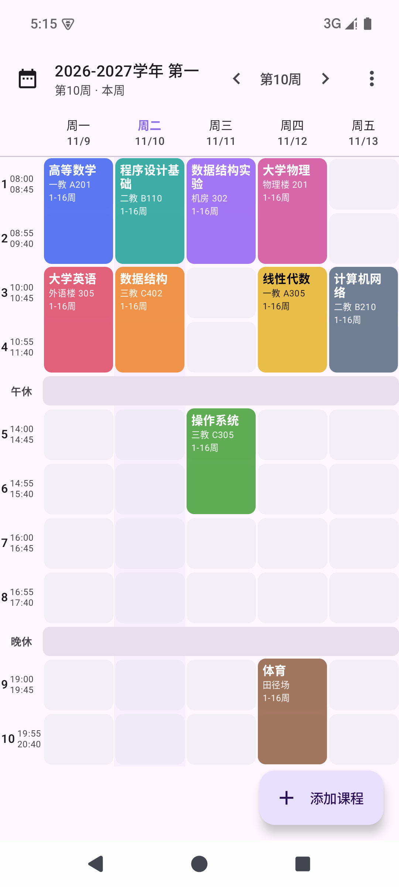
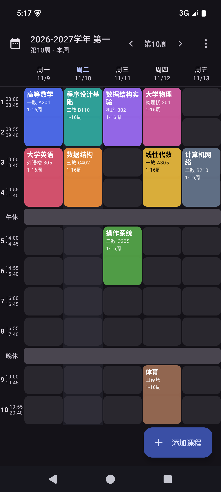
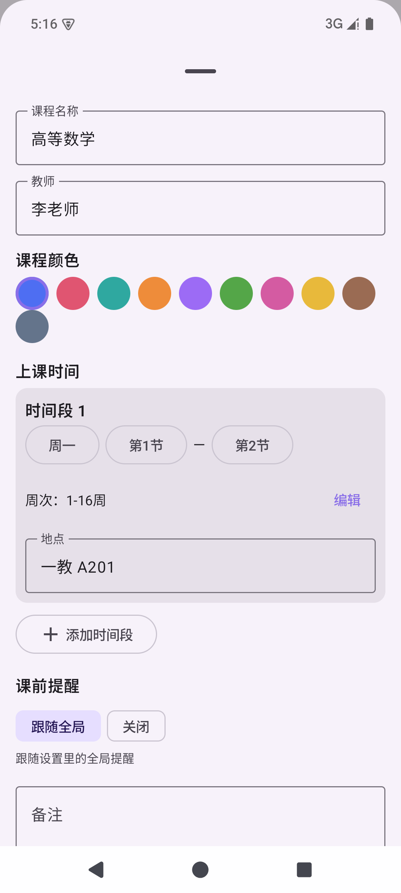
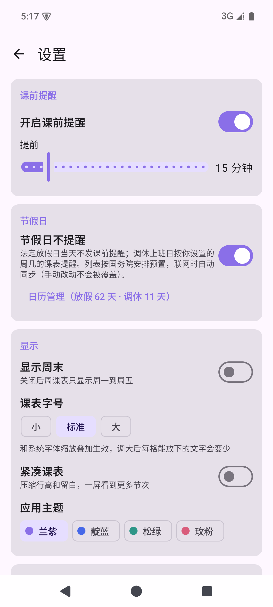

[English](README.md) | **简体中文**

  

  # 苦瓜课表

  **完全离线的安卓课程表 · 无账号 · 课前提醒 · 桌面小组件**

  导入一次课表，即可查看、编辑课程并在课前收到提醒。无需注册登录，课表数据永不出设备。

  
  
  
  
  

  **[下载安装](#-下载安装) · [功能特性](#-功能特性) · [联网与隐私](#-联网与隐私) · [从源码构建](#-从源码构建)**

## 📷 截图

<table align="center">
  <tr>
    <td align="center"> <b>周课表</b>（自动计算周次）</td>
    <td align="center"> <b>深色模式</b>（跟随系统）</td>
    <td align="center"> <b>课程编辑</b>（任意周次集合）</td>
    <td align="center"> <b>设置</b>（提醒 / 节假日 / 主题）</td>
  </tr>
</table>

## 📥 下载安装

前往 [**Releases 最新版**](https://github.com/Balsam1213/bitter-melon-timetable/releases/latest)，按设备架构选择 APK（要求 Android 8.0 及以上）：

| APK | 适用设备 |
|---|---|
| [`app-arm64-v8a-release.apk`](https://github.com/Balsam1213/bitter-melon-timetable/releases/latest/download/app-arm64-v8a-release.apk) | 绝大多数近年的手机（**推荐**） |
| [`app-armeabi-v7a-release.apk`](https://github.com/Balsam1213/bitter-melon-timetable/releases/latest/download/app-armeabi-v7a-release.apk) | 较老的 32 位手机 |
| [`app-x86_64-release.apk`](https://github.com/Balsam1213/bitter-melon-timetable/releases/latest/download/app-x86_64-release.apk) | 模拟器 / x86 设备 |
| [`app-universal-release.apk`](https://github.com/Balsam1213/bitter-melon-timetable/releases/latest/download/app-universal-release.apk) | 不确定架构时的通用包（体积更大） |

> [!IMPORTANT]
> v1.3 及更早版本为 debug 签名，v1.4 起改用正式签名：**从旧版本覆盖安装前需先卸载**，再通过 JSON 备份（手动导出的文件，或「文档 / 苦瓜课表」里的每日自动备份）恢复数据。此后签名保持不变，可正常覆盖升级。

## ✨ 功能特性

- **周课表视图** — 按周显示课程，自动计算「今天是第几周」；左右滑动切周、下拉跳周、今天高亮；周末列可开关。

- **五种导入方式** — 全部先进入预览确认再写入：有问题的条目会红字标注原因并默认不勾选，修改后仍可勾选导入。
  - Excel (.xlsx) / CSV 文件（UTF-8 / GBK 编码均可）
  - JSON 备份文件（本应用导出的格式）
  - 课表截图离线识别（ML Kit 中文 OCR，识别模型内置 APK，不联网）
  - 手动添加
  - 教务网导入（需联网）

  

  
教务网导入的细节与安全措施

  在应用内 WebView 打开你学校的教务网（默认西南交大，可改为任意学校网址），手动登录后进入「我的选课记录」或「本学期周课表」页面，一键解析导入。明文 http 地址与证书异常都会先弹窗告知风险（凭据可能被窃听）、确认后才继续，跳转到其他网站同样需要确认；兼容 http 子站与自签证书的校内系统，支持双指缩放；个别学校后台首页 CSS 高度塌陷导致白屏的会自动修复。抓取的页面只在本地解析，课表数据不上传。

  

- **课程管理** — 一门课可含多个时间段；**任意周次集合**（如「1-8, 11-16 周」，单双周只是快捷选择）；自定义颜色、教师、地点、备注；保存时自动检测时间冲突；「全部课程」页按名称 / 教师 / 地点快速搜索。

- **课前提醒** — 全局提前 0–120 分钟可调，单门课程可单独关闭；通过精确闹钟触发，重启手机 / 覆盖安装后自动重排；闹钟走 `setAlarmClock` 通道，免受深度休眠（Doze）合批与厂商省电限制，隔夜后的早八提醒也准时触发；通知带横幅、声音与震动；精确闹钟或通知权限受限时，设置页红字提示并一键引导开启。

- **节假日与调休** — 日历式管理（设置 → 节假日 → 日历管理）：放假日标「休」（红），当天不发提醒；调休上班日标「班」，按你指定的周几课表提醒（默认按当天星期）。数据按国务院 2026 年安排预置（含 6 天调休上班日），联网时自动同步最新官方安排（holiday-cn 数据源，次年安排公布后自动补全）；手动改动过的日期永不被同步覆盖。

- **桌面小组件** — 「今日课程」：今日课程列表、正在上的课高亮、点击进入 App，法定放假日显示「今天放假」，调休上班日按指定周几显示；「本周课程」（约 4×3）：一天一列的本周概览，今天列高亮，列数跟随「显示周末」设置。

- **学期与节次** — 多学期管理（开学日期决定周次、总周数、设为当前 / 归档 / 删除），新学期可复制旧学期节次；每节课的起止时间自由编辑、增删，适配不同学校作息。

- **备份与迁移** — 每天自动把当前学期备份为 JSON 到「文档 / 苦瓜课表」（保留最近 7 份），可在设置中关闭或立即备份，备份状态可见（成功时间 / 失败红字）；JSON 导入 / 导出用于换机迁移；课表可一键渲染为图片保存或分享。

- **显示与个性化** — 课表字号三档（与系统字体缩放叠加）；紧凑模式只压行高、不缩字号；应用主题四选一（兰紫 / 靛蓝 / 松绿 / 玫粉）即时切换；深色模式跟随系统。

## 🚀 快速上手

1. 首次启动直接点「导入课表」：还没有学期时会先弹出学期信息确认窗（名称 / 开学日期 / 总周数可改），核对后再入库；也可以先在「学期管理」手动新建学期。
2. Excel / CSV 导入模板见 [模板/课程表导入模板.csv](模板/课程表导入模板.csv)，JSON 格式见 [模板/课程表示例.json](模板/课程表示例.json)。
3. 在「节次时间」里核对本校每节课的起止时间（内置一套常用模板，可自由增删改）。
4. 提醒设置在「设置」中；单门课程可在课程编辑页单独关闭提醒。

## 🔒 联网与隐私

应用无任何账号体系，课表数据仅存于本机数据库（`timetable.db`）。唯一申请的 `INTERNET` 权限只被下面后两项使用：

| 功能 | 联网行为 |
|---|---|
| 课表查看 / 编辑 / 搜索 / 分享 | 完全本地运行 |
| 截图识别（OCR） | 中文识别模型内置 APK，不需要网络 |
| 备份与导出（JSON / 课表图片 / 每日自动备份） | 本地处理 |
| 教务网导入 | 用户主动触发：应用内 WebView 打开教务网。明文 http 地址会先弹风险确认（凭据可能被窃听），证书异常逐站确认，跳转其他网站需确认；抓取的页面只在本地解析，课表数据不上传 |
| 节假日同步 | 联网拉取 holiday-cn 公开数据（3 个 https CDN 镜像）；失败时静默跳过，继续使用内置的国务院预置数据；手动改动过的日期永不被同步覆盖 |

## 🔨 从源码构建

- 环境：Android Studio（推荐用其内置 JBR 作为 Gradle JDK，JDK 17+ 均可）+ Android SDK
- 常用命令：
  - `./gradlew :app:assembleDebug` — 调试包（全 ABI，开发用）
  - `./gradlew :app:assembleRelease` — 发布包（R8 混淆 + 资源压缩 + ABI 拆分）
  - `./gradlew :app:testDebugUnitTest` — 单元测试
  - `./gradlew :app:lintDebug` — Lint 检查
- 发布签名：优先读取仓库根目录的 `keystore.properties`（含 `storeFile` / `storePassword` / `keyAlias` / `keyPassword`）。该文件与 keystore 均不入仓库，请自行生成并妥善备份；文件缺失时回退 debug 签名（仅限本地调试，不可用于发版）。
- 若工作区路径包含非 ASCII 字符，AGP 会要求开启 `android.overridePathCheck=true`（本仓库已默认开启）。

## 🧱 技术栈

| 分类 | 技术 |
|---|---|
| 语言 / UI | Kotlin · Jetpack Compose + Material 3 |
| 数据 | Room（本地数据库 `timetable.db`）· DataStore |
| 后台 | WorkManager（每日自动备份）· 精确闹钟（课前提醒） |
| 小组件 | Glance（今日课程 / 本周课程） |
| 识别 / 解析 | ML Kit 中文文字识别（离线模型内置）· Jsoup（教务网页面解析） |
| 工程 | Gradle version catalog · Lint 门禁 · 单元测试覆盖解析与提醒核心逻辑 |

## 📂 项目文档

- [devlog/](devlog/) —— 更新日志（CHANGELOG）、待办事项（TODO）与按日开发日志
- [docs/](docs/) —— 需求说明、技术架构、设计规范、开发流程

## ⚠️ 已知限制

- 旧版 `.xls`（非 xlsx）不支持，请先用 Office/WPS 另存为 `.xlsx`
- 截图识别效果取决于图片清晰度与排版规整度，识别结果务必人工确认
- 国产 ROM（小米/华为等）需要手动允许「自启动」与「后台弹出界面」，否则通知可能被延迟

## 🐛 问题反馈

欢迎通过 [Issues](https://github.com/Balsam1213/bitter-melon-timetable/issues) 反馈问题或功能建议，请尽量附上导入文件格式（脱敏后）、系统版本与复现步骤。

## 📄 许可证

本项目以 [MIT License](LICENSE) 开源。
